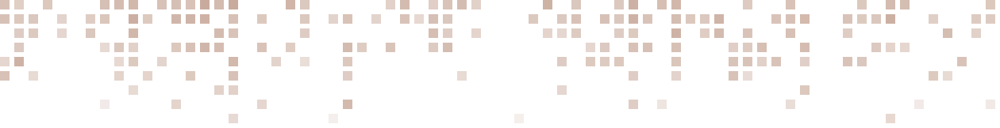
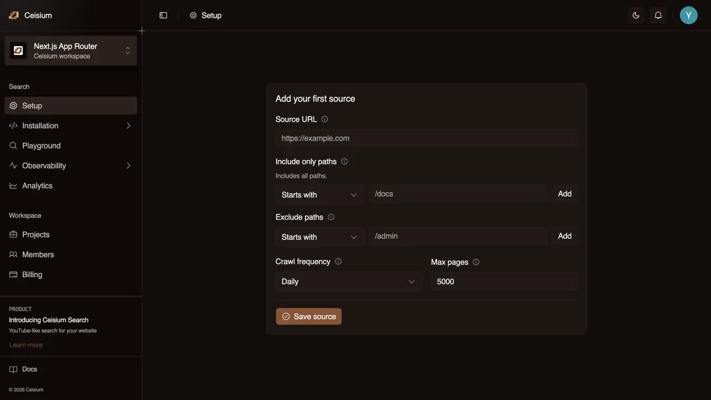
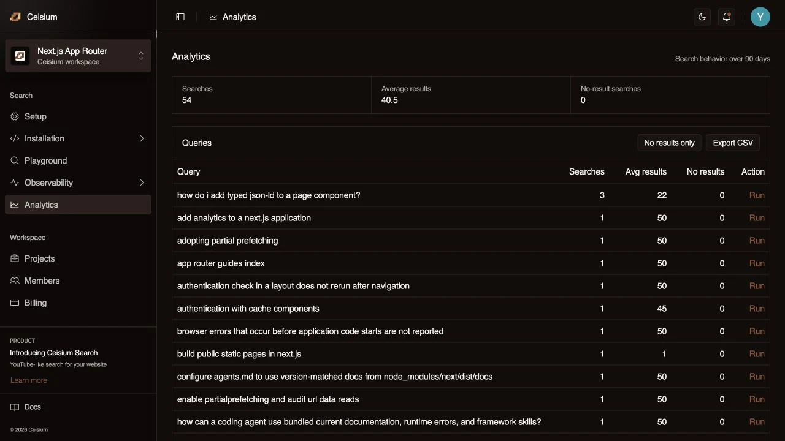
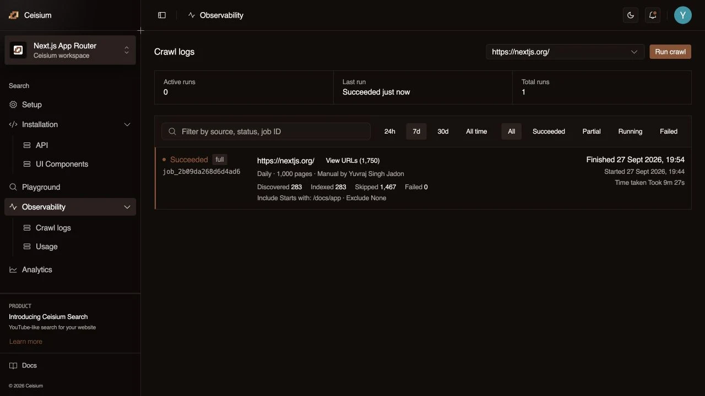

  <a href="https://ceisium.com/">
    <picture>
      <source media="(prefers-color-scheme: dark)" srcset="https://raw.githubusercontent.com/Ceisium/.github/main/profile/assets/logo-dark.svg">
      
    </picture>
  </a>
   
  <strong>Ceisium Search</strong>

<h1 align="center">The simplest intent-aware search for your website and docs.</h1>

  Search that understands what you’re looking for, 
  even when you don’t know the exact words.

  <a href="https://ceisium.com/app">Try Ceisium Search →</a>
  &nbsp; · &nbsp;
  <a href="https://ceisium.com/developers/">Developers</a>
  &nbsp; · &nbsp;
  <a href="https://ceisium.com/benchmark/">Benchmark</a>
  &nbsp; · &nbsp;
  <a href="https://ceisium.com/pricing/">Pricing</a>

## Works out of the box.

Add your website URLs, choose the pages to include, and connect the Search API to your own search interface.

**Ceisium Search handles crawling, indexing, ranking, and scheduled updates as your website changes.** Your team can focus on its website and docs without ongoing manual relevance tuning.

## See what visitors search for.

Inspect queries, search counts, and searches with no results.

## Keep content current.

Track crawl status and discovered, indexed, skipped, and failed pages.

## Latest benchmark — 8 November 2026

1,000 Next.js App Router documentation queries across 298 crawled pages, measured from India.

- **98.1% Hit@3** — an expected page in the first three results for 981 of 1,000 queries.
- **98.7% Hit@10** — an expected page in the first ten results.
- **0.9415 MRR@10** and **0.9532 nDCG@10**.
- **978 ms client P95**, **693 ms median**, and **0 failed requests**.

Ceisium Search used the settings generated for this website, with no manual relevance adjustments. These results apply to this dated corpus and query set.

[Read the benchmark, methodology, and fixed query set →](https://ceisium.com/benchmark/)

[Setup guide](https://ceisium.com/docs/) · [Published benchmark](https://ceisium.com/benchmark/) · [Latest updates](https://ceisium.com/changelog/)
